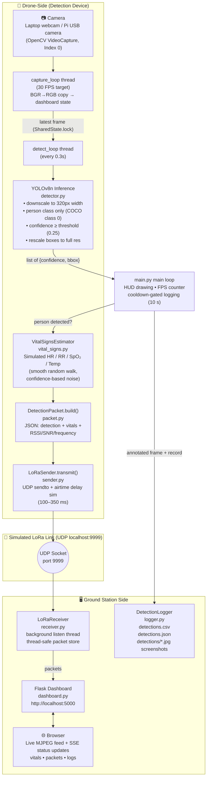
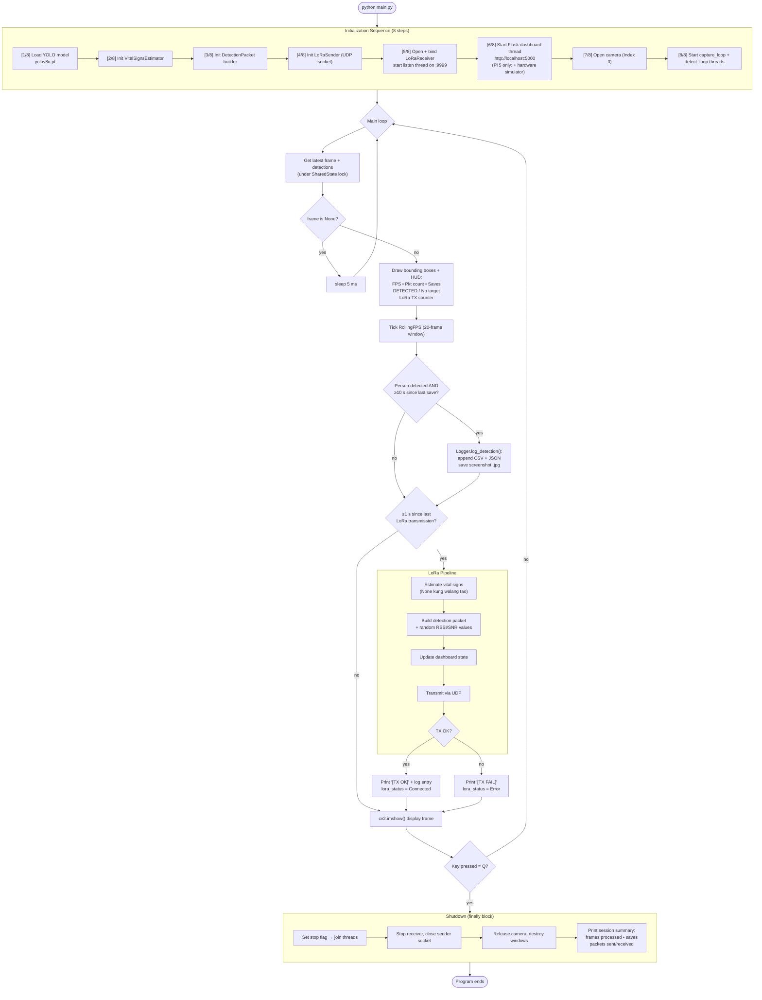

# Human Detection Prototype — Complete Project Documentation

> Isang dokumento para ma-read mo **lahat** — architecture, bawat module, data flow,
> mga flowchart, setup, at configuration. Huling update: August 23, 2026.

---

## Table of Contents

1. [Project Overview](#1-project-overview)
2. [Repository Structure](#2-repository-structure)
3. [System Architecture (Flowchart)](#3-system-architecture-flowchart)
4. [Runtime Flow (Main Loop Flowchart)](#4-runtime-flow-main-loop-flowchart)
5. [Module Reference](#5-module-reference)
6. [Data Formats](#6-data-formats)
7. [Ground Station Dashboard (Flask)](#7-ground-station-dashboard-flask)
8. [Health Dashboard — Project DELTA](#8-health-dashboard--project-delta)
9. [Deployment Variants: Laptop vs Pi 4B vs Pi 5](#9-deployment-variants-laptop-vs-pi-4b-vs-pi-5)
10. [Setup & Running](#10-setup--running)
11. [Configuration Constants](#11-configuration-constants)
12. [Troubleshooting](#12-troubleshooting)

---

## 1. Project Overview

Educational, prototype-stage na **human detection pipeline** na nag-simulate ng
vision system ng isang surveillance / search-and-rescue drone para sa **DRRM
(Disaster Risk Reduction and Management)**.

**Ano ang ginagawa nito:**

1. Kumukuha ng live video mula sa camera (laptop webcam o USB camera sa Raspberry Pi).
2. Tumatakbo ng totoong CNN object detector (**YOLOv8n**) sa bawat frame.
3. Nag-dodrawing ng bounding boxes + confidence scores sa mga nakitang tao.
4. Nagge-generate ng **simulated vital signs** (heart rate, respiration, SpO₂, temperature)
   kapag may na-detect na tao.
5. Nagbubuo ng **detection packet (JSON)** na may detection + vitals + LoRa transmission metadata.
6. Nagpapadala ng packet gamit ang **simulated LoRa link** (UDP socket).
7. Nagre-receive ang **Ground Station Dashboard** (Flask web UI) at ipinapakita ang live feed,
   detection status, vitals, at packet history.
8. Nila-log ang bawat detection event sa CSV/JSON + screenshot.

> ⚠️ **Prototype ito para sa pag-aaral**, hindi production surveillance/rescue system.
> Hindi pa na-validate ang accuracy, latency, at reliability para sa safety-critical use.

---

## 2. Repository Structure

```
HumanDetectionPrototype/
│
├── main.py                  # Entry point: video loop, FPS, logging, LoRa pipeline, display
├── detector.py              # YOLOv8n CNN wrapper (person-only detection)
├── human_detection.py       # Clean interface wrapper sa detector.py
├── vital_signs.py           # Simulated vital signs (HR, RR, SpO₂, Temp) — random-walk model
├── packet.py                # Detection packet JSON schema builder/parser
├── sender.py                # Simulated LoRa sender (UDP)
├── receiver.py              # Simulated LoRa receiver (UDP) — thread-safe packet store
├── dashboard.py             # Flask Ground Station web UI (live feed + SSE updates)
├── logger.py                # CSV + JSON detection logging, screenshots
├── utils.py                 # Shared constants (ports, ranges) + timestamp/format helpers
│
├── detections.csv           # Detection log (timestamp, confidence, frame_number)
├── detections.json          # Parehong data sa JSON format (para sa dashboard use)
├── yolov8n.pt               # YOLOv8 Nano pretrained weights (~6 MB)
├── requirements.txt         # Python dependencies
├── README.md                # Orihinal na readme (phone-camera era)
├── SETUP.txt                # Quick start commands (venv setup)
├── PROJECT-DELTA-UPDATE.md  # Update doc para sa health dashboard + Pi touchscreen
│
├── health-dashboard/        # Project DELTA: Student Health Dashboard (pure HTML/CSS/JS)
│   ├── index.html           # Page structure
│   ├── styles.css           # Lahat ng styling kasama ang Pi screen mode
│   ├── main.js              # Rendering + interactions + boot sequence
│   ├── data.js              # Data layer: simulation, status rules, heat-stress engine, pH zones
│   └── HEAT-STRESS.md       # Heat stress formula derivation + pH strip documentation
│
├── raspberry-pi-4b/         # Buong pipeline, inadapt para sa Raspberry Pi 4 Model B
│   ├── config.py            # Device identity metadata (BCM2711, 4GB RAM)
│   └── (parehong modules gaya ng root, USB camera version)
│
└── raspberry-pi-5/          # Buong pipeline, inadapt para sa Raspberry Pi 5
    ├── config.py            # Device identity metadata (BCM2712, 8GB RAM)
    ├── hardware_simulator.py  # Simulated Pi telemetry (CPU/RAM/temp/uptime)
    └── (parehong modules gaya ng root + hardware simulator integration)
```

---

## 3. System Architecture (Flowchart)

Buong data flow mula camera hanggang dashboard:



---

## 4. Runtime Flow (Main Loop Flowchart)

Ang eksaktong daloy ng `main.py` — initialization, threads, at ang main loop decision logic:



---

## 5. Module Reference

### `main.py` — Entry Point (v7: LoRa + Dashboard)

Pinag-isang pipeline orchestrator. Key components:

| Component | Linya / Role |
|---|---|
| `CONFIDENCE_THRESHOLD = 0.25` | Minimum YOLO confidence para ituring na tao |
| `TARGET_CAPTURE_FPS = 30` | Capture thread pacing |
| `DETECT_INTERVAL_SEC = 0.3` | Detection runs ~3×/second (CPU-friendly) |
| `LOG_COOLDOWN_SEC = 10.0` | Hindi masyadong madalas mag-save ng screenshot/log |
| `LORA_TX_INTERVAL = 1.0` | Maximum 1 packet kada segundo |
| `SharedState` | Thread-safe bridge: `lock`, `frame`, `detections`, `stop` flag |
| `capture_loop()` | Thread: read frames → convert RGB → feed `dash_state` → store latest frame |
| `detect_loop()` | Thread: copy latest frame → YOLO inference → store detections |
| `RollingFPS` | FPS counter gamit ang sliding window ng huling 20 frame timestamps |
| `hud_text()` | May background rectangle na HUD text overlay |
| `draw_detections()` | Green boxes + % labels sa OpenCV window |

### `detector.py` — HumanDetector (v6)

YOLOv8n wrapper optimized for CPU-only machines:

- **Class filtering**: COCO class `0` (`person`) lang — `classes=[0]` sa `model.predict()`.
- **Downscale trick**: Binebaba ang frame sa **320px width** bago mag-inference
  (mas mabilis sa CPU), tapos ibinabalik ang bbox coordinates sa orihinal na resolution.
- **Validation**: tinatanggihan ang None frames / wrong shape; kino-coerce ang dtype sa uint8.
- **Degenerate box filter**: nilalaktawan ang zero-width/height boxes pagkatapos ng rounding.
- Returns: `(annotated_frame, [{"confidence": float, "bbox": (x1,y1,x2,y2)}, ...])`.

### `human_detection.py` — Unified Interface

Thin wrapper na nagde-delegate kay `HumanDetector`. Ang pipeline ay gumagamit nito;
kapag napalitan ang detection backend, dito lang gagalaw.

### `vital_signs.py` — VitalSignsEstimator

Simulated vital signs estimation (walang totoong sensor):

- Kung **walang tao** → returns `None`, reset ang internal clock.
- Kung **may tao** → smooth random walk kada call:
  - `step = random(-0.6, 0.6) × noise_scale × dt` — kapag mas mataas ang confidence,
    mas maliit ang noise (`noise_scale = max(0.3, 1.5 − confidence)`).
  - Values clamped sa physiologic ranges mula sa `utils.VITAL_SIGNS_RANGE`.
- Output: `{"heart_rate", "respiration", "spo2", "temperature"}` (rounded, 1 decimal).

### `packet.py` — DetectionPacket

Static builder/parser ng JSON packet (tingnan ang [Data Formats](#6-data-formats)).
Kapag walang tao, walang `vital_signs` field sa packet; ang `bbox` ay optional.

### `sender.py` — LoRaSender (simulated)

- UDP socket (`SOCK_DGRAM`) papunta sa `LORA_HOST:LORA_PORT`.
- Bago mag-send: sine-simulate ang **LoRa airtime delay**
  (`random(80–150 ms) + payload_len × 0.05 ms/byte`) — para makatotohanan.
- Returns `True/False`; binibilang ang `packets_sent`.
- Swappable sa totoong LoRa hardware (hal. SX1278 via SPI) — palitan lang ang transport layer.

### `receiver.py` — LoRaReceiver (simulated)

- Binibind ang UDP socket sa `:9999` na may 0.5 s timeout.
- Background thread (`_listen_loop`): JSON decode → validate → store sa thread-safe buffer.
- Nilalagay sa `logs` list (max 300 entries): packet ID, DETECTED/NO TARGET, sender addr, bytes.
- Malinis na hina-handle ang malformed JSON at socket errors.
- Public reads: `packet_count`, `latest_packet`, `all_packets`, `logs`, `connection_status`.

### `logger.py` — DetectionLogger (v5)

Sa bawat `log_detection(confidence, frame_number, frame_image)`:

1. Append row sa `detections.csv` (`timestamp, confidence, frame_number`).
2. Append record sa in-memory list → rewrite `detections.json` (indent=4).
3. Kung may frame image: i-save ang screenshot sa `detections/person_YYYYMMDD_HHMMSS.jpg`
   (may milliseconds para walang collision sa bursts).

Auto-create ng files + header sa startup; naglo-load ng existing JSON history.

### `utils.py` — Shared Constants & Helpers

```python
LORA_HOST = "localhost"; LORA_PORT = 9999      # simulated LoRa link
PACKET_VERSION = "1.0"
VITAL_SIGNS_RANGE = { heart_rate:(60,100) bpm, respiration:(12,20),
                      spo2:(95,100) %, temperature:(36.0,37.5) °C }
LORA_FREQUENCY_MHZ = 915.0
LORA_RSSI_RANGE = (-90,-50) dBm ; LORA_SNR_RANGE = (5.0,12.0) dB
DASHBOARD_HOST = "0.0.0.0" ; DASHBOARD_PORT = 5000
```

Plus timestamp helpers (`timestamp_now` may ms, `timestamp_short` HH:MM:SS)
at formatting helpers (confidence/HR/RR/SpO₂/temp).

---

## 6. Data Formats

### Detection Packet Schema (packet.py v1.0)

```json
{
    "packet_id": 1,
    "version": "1.0",
    "timestamp": "2026-07-10 12:00:00.123",
    "detection": {
        "person_detected": true,
        "confidence": 0.93,
        "bbox": [120, 84, 310, 420]
    },
    "vital_signs": {
        "heart_rate": 78.4,
        "respiration": 15.2,
        "spo2": 97.8,
        "temperature": 36.8
    },
    "transmission": {
        "rssi": -67.3,
        "snr": 8.4,
        "frequency_mhz": 915.0
    }
}
```

Notes:
- `bbox` — kasama lang kapag may detection.
- `vital_signs` — kasama lang kapag `person_detected == true`.
- `rssi`/`snr` — random values sa loob ng configured ranges (simulation).

### Detection Log Entries (CSV / JSON)

```
timestamp,confidence,frame_number     ← CSV header
2026-06-24 18:22:15,0.93,125          ← CSV row
```

```json
[{ "timestamp": "...", "confidence": 0.93, "frame_number": 125 }]
```

Screenshots: `detections/person_YYYYMMDD_HHMMSS_mmm.jpg` (annotated frames).

### Health Dashboard Snapshot (data.js)

```js
{
  link: "OK",                       // o "ACQUIRING"
  overall: { key, label },          // STABLE / MONITORED / ATTENTION
  heatStress: { pct, level, label, inputs: {T,E,L} },
  ph: { value, zone: {id,name,range} },
  metrics: {
    electrolytes: { value, unit:"%",      status:{key,label} },
    hydration:    { value, unit:"%",      status },
    stress:       { value, unit:"%",      status },
    sodium:       { value, unit:"mEq/L",  status },
    lactate:      { value, unit:"mmol/L", status },
    temperature:  { value, unit:"°C",     status }
  },
  recommendations: [ { id, icon, theme, title, desc } ]   // max 3
}
```

---

## 7. Ground Station Dashboard (Flask)

`dashboard.py` — DRRM command centre, tumatakbo sa sariling **daemon thread**.

### Shared State (`DashboardState`)

Thread-safe (may `Lock`) na global instance na `state`:
- `update_frame()` — tinatawag ng capture loop (RGB frames).
- `update_detection()` — tinatawag ng main loop kada LoRa TX (detections + vitals + packet);
  nag-a-append din sa `detection_history` (max 100).
- `add_log()` — system log entries (max 200).
- `get_status()` — JSON snapshot ng lahat ng display values.

### Routes

| Route | Method | Description |
|---|---|---|
| `/` | GET | Dashboard HTML page (inline template, dark command-centre theme) |
| `/video_feed` | GET | **MJPEG stream** ng live feed na may green bounding boxes + "DRRM GROUND STATION" label (~30 fps, JPEG quality 70) |
| `/events` | GET | **Server-Sent Events**: JSON status push ~4×/s (auto-update UI) |
| `/api/status` | GET | Plain JSON polling endpoint |

### What the UI shows

Header (DRRM Ground Station + packet count badge), Live Camera Feed
(FPS badge + DETECTED/NO TARGET badge), Detection History table
(time, conf, HR, RR, SpO₂, temp), System Information (LoRa status,
connection, packet count, last TX), Vital Signs cards, Latest Detection panel,
at System Log feed.

---

## 8. Health Dashboard — Project DELTA

`health-dashboard/` — hiwalay na **student health monitoring dashboard**
(pure static HTML/CSS/JS, walang build step). Tingnan din ang
`PROJECT-DELTA-UPDATE.md` at `health-dashboard/HEAT-STRESS.md`.

### Panels

- Header na may live clock · Vital Signs row (Electrolytes, Hydration, Stress)
- Electrolyte Breakdown (Sodium + Lactate)
- Stress/Temperature cards · Recommendations feed (max 3, may Acknowledge button)

### Face-detection gate (biometric flow)

Ang dashboard values ay hinihinge ng **face detection** mula sa camera:

```
Camera (getUserMedia) → FaceMonitor presence check → data layer
  FACE DETECTED   → baseline readings + status pills + recommendations
  WALANG MUKHA    → LAHAT NG VALUES = 0 · STANDBY · "NO SIGNAL" sa recs
```

- Values ay **event-driven** — hindi na random-walk auto-update. Bagong
  detection session = fresh baseline (72% / 54% / 81% / 138 / 2.8 / 37.4).
- Ang avatar circle sa patient card ay nagiging **live camera feed** (mirrored),
  may scanning animation habang naghahanap ng mukha, at berdeng ring kapag
  nadetect ang mukha.
- `camera-monitor.js` (`FaceMonitor`) — camera + zero-dependency presence
  heuristic (skin-tone ratio + brightness, debounced). Isolated ang detector
  para mapalitan ng totoong face-detection model balang-araw.
- `db.js` (`DeltaDB`) — localStorage database: sessions (start/end) +
  samples kada 10s habang present. Console API:
  `DeltaDB.listSessions()`, `DeltaDB.listSamples(10)`, `DeltaDB.clearAll()`.

> Tandaan: Ang Heat Stress panel at Sweat pH Strip visual ay inalis na sa UI
> (hindi bahagi ng orihinal na dashboard). Ang mga computation — `computeHeatStress()`,
> `PH_ZONES`/`phZone()`, at `buildAssessment()` — ay nananatiling gumagana sa
> `data.js` para sa future use.

### Heat Stress Formula (per project spec)

```
Heat Stress % = (0.55 × T_norm) + (0.25 × ELEC) + (0.20 × LAC_norm)
```

Normalization (raw → 0–100 risk scale):

| Input | Normalization |
|---|---|
| Temperature | `((°C − 36.5) / 3.0) × 100` — 36.5 °C=0%, 39.5 °C=100% |
| Electrolytes | direct 0–100 index pass-through |
| Lactate | `((mmol/L − 1.0) / 4.0) × 100` — 1.0=0%, 5.0=100% |

Classification: **≤33% LOW · 34–66% MODERATE · ≥67% HIGH**

### Sweat pH Zones (Bromocresol Green strip)

| Zone | pH range | Meaning |
|---|---|---|
| BLUE | ≥ 5.4 | resting/default |
| GREEN | 4.6–5.3 | mild exertion |
| YELLOW-GREEN | 3.9–4.5 | heavy exertion |
| BRIGHT YELLOW | ≤ 3.8 | extreme exhaustion |

Simulated pH: `target_ph = 6.7 − intensity × 3.0` where
`intensity = avg(stress%, lactate_norm%)`, smoothed random walk.

### File roles

- **`data.js`** (hardware-independent data layer): `STATUS_RULES`, `OVERALL_RULE`,
  `computeHeatStress()`, `PH_ZONES`/`phZone()`, `REC_LIBRARY`,
  `createSimulatedDataSource()` / `createDeviceDataSource()` (2-second tick random
  walk + operator commands: `hydrate` / `breathe`). Ang device source ay tumatanggap
  ng validated colorimetric readings via `pushStripMeasurement()` — kapag fresh (<2 min)
  ang reading, ito ang nagtatakda ng dashboard pH na may `source:"DEVICE"` tag;
  kung hindi, bumabalik sa `SIMULATED`. Para sa real sensors: palitan ang data provider
  — walang babagan sa UI/formulas.
- **`main.js`** (rendering): boot sequence, `renderMetrics()`,
  `renderRecommendations()`, acknowledge actions, live clock.
- **`styles.css`**: buong styling kasama ang dedicated layout mode para sa
  Pi 7-inch 1024×600 touchscreen (kiosk mode).

### Colorimetric strip device pipeline (hardware integration) — DORMANT

> **Tandaan:** Ang device/colorimetric modules ay naka-save sa folder para sa
> future hardware integration, pero **hindi kasalukuyang naka-load** ng
> `index.html` at walang anumang UI — ang dashboard UI ay nananatiling eksakto
> sa dati. Para i-enable: ibalik ang apat na `<script>` tags bago ang `main.js`
> at gamitin ang `window.DashboardData.createDeviceDataSource()`.

```
Camera/Controlled Lighting → ROI extraction → RGB analysis → quality gate
  → calibrated color match (o uncalibrated hue estimate, capped confidence)
    → pH interpretation → validation → pushStripMeasurement() → Dashboard
```

- **`strip-analysis.js`** — pure image processing: `extractROI` (normalized 0–1 ROI),
  `analyzePixels` (avg RGB + brightness/saturation/hue), `assessQuality`
  (too dark/bright/washed-out gates), `matchCalibrated` (nearest-reference Euclidean
  matching), `estimateZoneFromHue` (uncalibrated fallback, confidence ≤55%).
- **`calibration.js`** — reference dataset store (localStorage, versioned keys).
  **Nagsisimula sa walang laman** — walang gawa-gawang RGB calibration values;
  ang mga points ay input ng operator mula sa totoong known-pH strips. May
  export/import JSON at measurement history (max 50).
- **`device.js`** — device state machine (`SIMULATION`/`LIVE_CAMERA` mode,
  lighting ON/OFF mock, READY→CAPTURING→ANALYZING→COMPLETE/ERROR processing states).
  Kapag walang camera, gumagamit ng synthetic dark-frame simulation.
- **`device-panel.js`** — UI wiring para sa Device Monitor / Strip Analysis /
  Calibration / Measurement Log panels (hindi kasalukuyang ginagamit).
- **`data.js`** — may `pushStripMeasurement()` + `createDeviceDataSource()`
  (dormant; validated readings lang ang tinatanggap).

> BCG behavior per source doc: yellow <3.8 · green 3.8–5.4 · blue >5.4 —
> consistent sa detailed DELTA zones (≤3.8 bright-yellow / 3.9–4.5 yellow-green /
> 4.6–5.3 green / ≥5.4 blue). Methodology references: Al Tamimi et al. 2023,
> Zhou et al. 2025 (camera RGB analysis ng BCG indicators) — methodological support,
> hindi proof of clinical validation.

---

## 9. Deployment Variants: Laptop vs Pi 4B vs Pi 5

Parehong-pareho ang pipeline sa tatlong folder — ang mga pinagkaiba:

| Aspect | Root (Laptop) | raspberry-pi-4b | raspberry-pi-5 |
|---|---|---|---|
| Camera source | Built-in laptop webcam | USB camera | USB camera |
| `config.py` | wala (nasa utils.py lahat) | ✅ device identity | ✅ device identity |
| Device identity prints | generic | "[Device] Raspberry Pi 4 Model B" + CPU/RAM/LoRa/camera info | "[Device] Raspberry Pi 5" + same |
| Hardware simulator | wala | wala | ✅ `hardware_simulator.py` |
| Window title | "Human Detection — DRRM Prototype" | "... (Raspberry Pi 4 Model B)" | "... (Raspberry Pi 5)" |
| Init steps | 8 steps | 8 steps | 8 steps + "[6.5/8] hardware simulator" |

**`config.py`** (Pi versions lang) — hardware/device metadata:
`DEVICE_NAME`, `DEVICE_VERSION="1.0"`, `CPU_MODEL` (BCM2711 / BCM2712),
`RAM_SIZE` ("4GB"/"8GB"), `STATUS="Ready"`, `LORA_MODE="Simulation Mode"`,
`CAMERA_NAME="USB Camera (Connected)"`.

**`hardware_simulator.py`** (Pi 5 lang) — dependency-free telemetry simulator:
- CPU usage %, RAM used/total, CPU temperature — smooth random walks
  (temp correlates loosely with usage).
- Uptime HH:MM:SS from process start; camera/LoRa/Python/OpenCV status.
- Background thread (2 s tick); `snapshot()` returns consistent copy;
  module-level singleton `simulator` — shared ng `main.py` at `dashboard.py`.
- Ipino-display ng Pi 5 dashboard bilang "Raspberry Pi 5 System Status" card.

> Ang `requirements.txt` ay identical sa tatlong variants. May kasamang
> `yolov8n.pt` weights ang bawat folder. (Tandaan: may kasamang `venv/`
> folders ang Pi folders — hindi kasama sa documentation na ito.)

---

## 10. Setup & Running

### Laptop / PC (root folder)

```bash
# 1. Virtual environment
python -m venv venv311
venv311\Scripts\activate

# 2. Install packages
pip install -r requirements.txt

# 3. Run
python main.py
```

Mga dependencies: `opencv-python`, `numpy`, `ultralytics` (YOLOv8),
`torch`/`torchvision`, `requests`, `pandas`, `flask`.
(Unang run: awtomatikong magda-download ng `yolov8n.pt` kung wala pa.)

**Habang tumatakbo:**
- OpenCV window "Human Detection — DRRM Prototype" — live feed + green boxes
  + FPS/packet/save counters.
- Browser: **http://localhost:5000** — DRRM Ground Station dashboard.
- Press **Q** sa video window para huminto (printout ng session summary).

### Raspberry Pi (4B o 5)

```bash
cd raspberry-pi-4b/    # o raspberry-pi-5/
pip install -r requirements.txt
python main.py         # USB camera sa Index 0
```

### Health Dashboard (standalone, walang Python)

1. Serve/buksan ang `health-dashboard/index.html` sa browser
   (o i-deploy kasama ng Node.js server — tingnan ang `PROJECT-DELTA-UPDATE.md` §6).
2. Awtomatikong gagalaw ang values (2 s simulation tick), lalabas ang
   recommendations, at gagalaw ang pH marker sa strip.

---

## 11. Configuration Constants

Lahat ng tunable values, kung saan sila nakalista:

| Constant | Value | File | Meaning |
|---|---|---|---|
| `CONFIDENCE_THRESHOLD` | 0.25 | main.py | Min YOLO confidence |
| `TARGET_CAPTURE_FPS` | 30 | main.py | Capture thread rate |
| `DETECT_INTERVAL_SEC` | 0.3 | main.py | Detection frequency (~3 Hz) |
| `LOG_COOLDOWN_SEC` | 10.0 | main.py | Min gap between saved detections |
| `LORA_TX_INTERVAL` | 1.0 s | main.py | Max packet rate |
| `CAMERA_INDEX` | 0 | main.py | Camera device index |
| `INIT_WIN_W/H` | 640×360 | main.py | Initial window size |
| `infer_w` / `imgsz` | 320 | detector.py | Downscaled inference resolution |
| `LORA_HOST:PORT` | localhost:9999 | utils.py | Simulated LoRa UDP endpoint |
| `LORA_FREQUENCY_MHZ` | 915.0 | utils.py | Nominal LoRa frequency |
| `LORA_RSSI_RANGE` | −90..−50 dBm | utils.py | Random RSSI sim range |
| `LORA_SNR_RANGE` | 5..12 dB | utils.py | Random SNR sim range |
| `VITAL_SIGNS_RANGE` | HR 60–100, RR 12–20, SpO₂ 95–100%, Temp 36–37.5 °C | utils.py | Physiological clamps |
| `DASHBOARD_HOST:PORT` | 0.0.0.0:5000 | utils.py | Flask dashboard bind |
| `PACKET_VERSION` | "1.0" | utils.py | Packet schema version |
| Device metadata | BCM2711/4GB · BCM2712/8GB | config.py (Pi only) | Identity/simulated specs |

---

## 12. Troubleshooting

| Problem | Likely Cause | Fix |
|---|---|---|
| `[ERROR] Could not open laptop/USB camera.` | Camera occupied o hindi connected | Isara ang ibang apps na gumagamit ng camera; i-check ang USB connection sa Pi |
| Black/frozen video window | Camera busy / driver issue | Restart the script; i-check ang camera index |
| Very low FPS / laggy | CPU-only inference | Expected sa CPU; babaan ang resolution, o palitan ng GPU/larger device kung available |
| `ModuleNotFoundError: ultralytics` (etc.) | Kulang ang dependencies | `pip install -r requirements.txt` sa tamang environment |
| Model download hang sa first run | Walang internet | Kumonekta nang isang beses para sa `yolov8n.pt` download |
| Walang detections lumalabas | Mababang confidence / dilim / hindi buo ang katawan sa frame | Babaan ang `CONFIDENCE_THRESHOLD` (hal. 0.35→0.25), paliitin ang lighting |
| Walang TX OK / dashboard disconnected | UDP port conflict sa :9999 | Siguraduhing walang ibang process sa port 9999 |
| Dashboard hindi mabuksan sa :5000 | Port already in use | Palitan ang `DASHBOARD_PORT` sa utils.py |
| `q` hindi gumagana sa OpenCV window | Window not focused | I-click muna ang video window bago pindutin ang q |
| detections.csv/json hindi nag-update | Cooldown (10 s) still counting | Maghintay, o babaan ang `LOG_COOLDOWN_SEC` |

---

*Documentation generated mula sa aktuwal na source code ng repository.
Para sa detalyadong heat-stress math: `health-dashboard/HEAT-STRESS.md`.
Para sa Project DELTA context: `PROJECT-DELTA-UPDATE.md`.*
